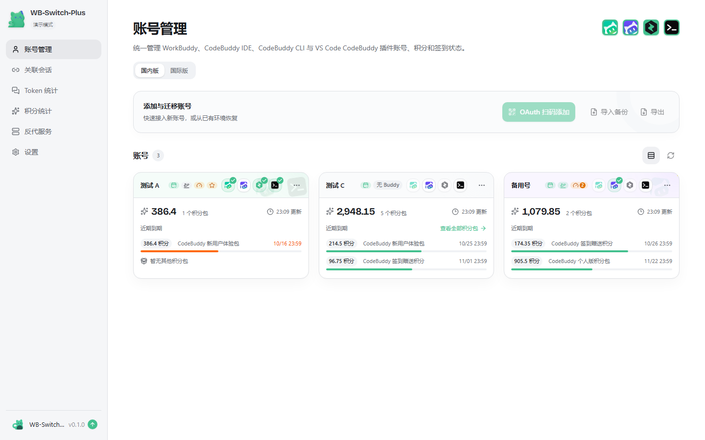
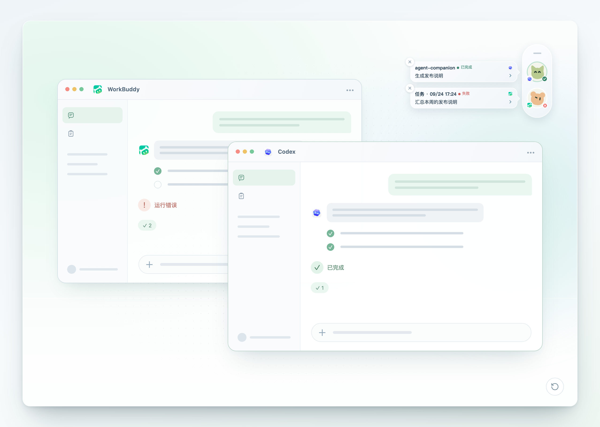
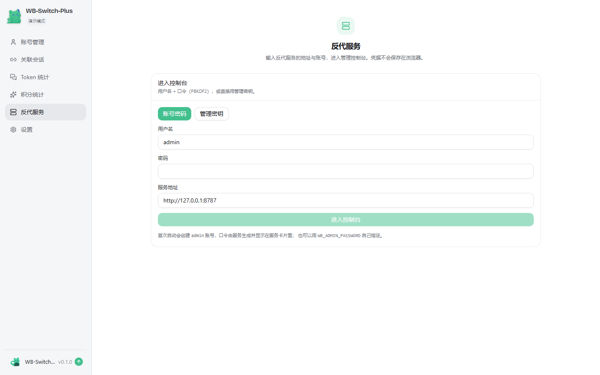
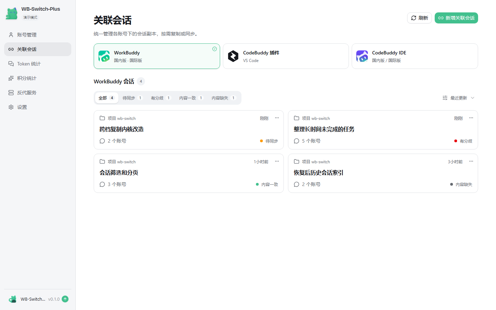
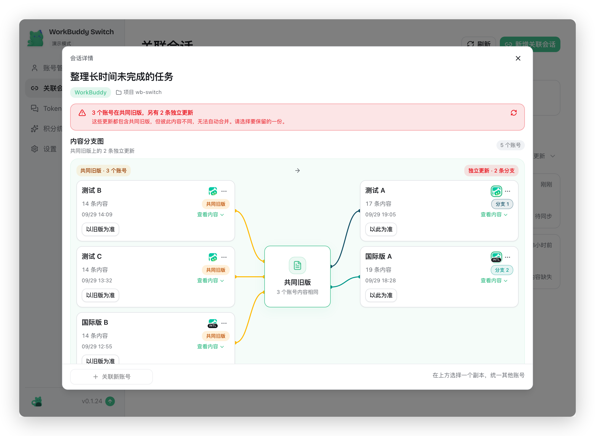
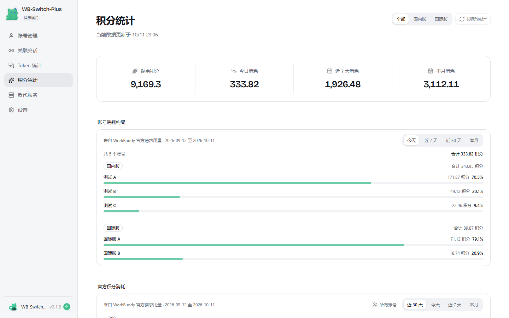
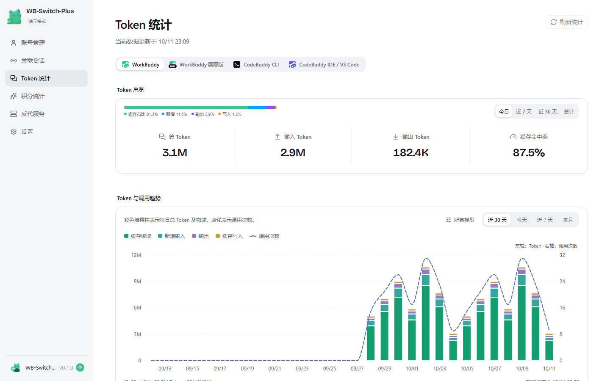
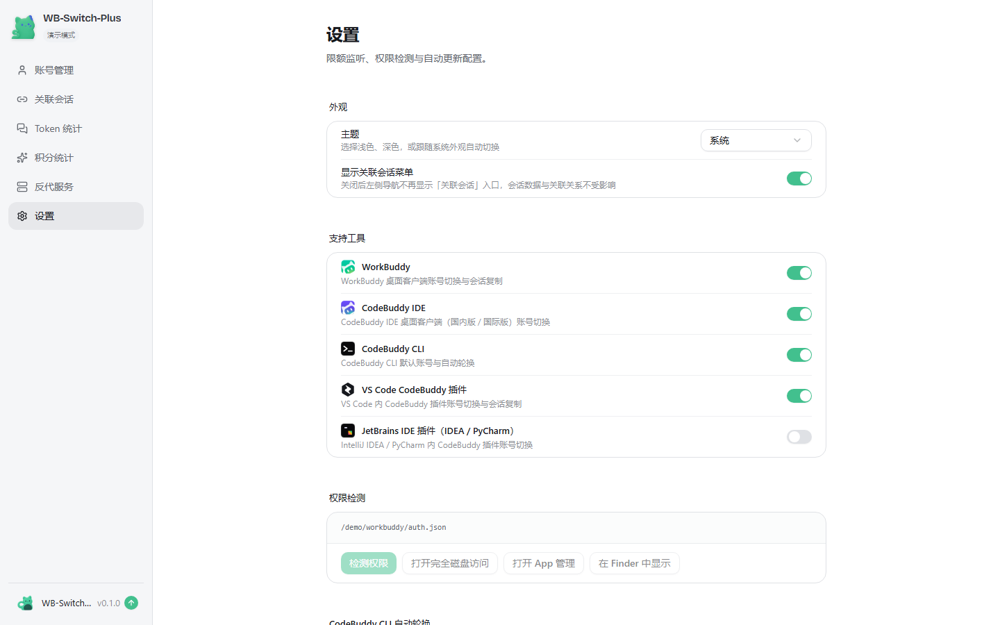

# WB-Switch-Plus（workbuddy-switch-plus）

WorkBuddy、CodeBuddy IDE、CodeBuddy CLI 与 VS Code / JetBrains CodeBuddy 插件的账号切换桌面 App（Tauri），各端均支持国内版 / 国际版，附积分到期与 Token 用量监控。



> 基于 [changexbc/workbuddy-switch](https://github.com/changexbc/workbuddy-switch) 二改。

## 与基底项目的差异

| 项 | changexbc/workbuddy-switch | 本仓库 |
| --- | --- | --- |
| 数据目录 | `~/.wb-switch` | **`~/.wb-switch-plus`**（首次启动从旧目录整份复制，旧目录不删） |
| 产品名 | workbuddy-switch | **WB-Switch-Plus** |
| 版本检查 / 更新源 | changexbc/workbuddy-switch | **Hyact/workbuddy-switch-plus** |
| 反代服务 | 无 | 内置（见下），桌面端托管、可打包为单文件 |
| 反代默认模型 | `auto` | **`deepseek-v4.1-flash`** |

数据目录改名是为了避免与上游互相覆盖账号库、会话关联与 hook 配置。

## 功能

| 模块 | 说明 |
| --- | --- |
| 账号管理 | OAuth 扫码登录、导入导出、删除 |
| 账号切换 | 一键切换 WorkBuddy 账号，实时显示进度 |
| 会话复制 | 把勾选的会话复制给目标账号，源账号数据不受影响 |
| 关联会话 | 复制过的会话自动建立跨账号关联；按客户端查看副本状态，支持增量同步与分歧处理 |
| 积分到期查询 | 自动查询各账号积分余量与到期时间，7 天内到期高亮并排序 |
| 积分统计 | 官方请求用量：总览、近 30 天趋势、模型分类、账号消耗与明细 |
| Token 统计 | 按来源的 Token 总览与趋势、构成占比、活跃热力图、项目 / 模型 Top 10 |
| CodeBuddy CLI | 与 WorkBuddy 复用账号库，默认账号独立，切换后立即生效 |
| CodeBuddy IDE | 切换桌面客户端账号，可在弹窗中勾选复制会话 |
| VS Code 插件 | 切换插件账号；VS Code 运行时可自动关闭并在写入后重开 |
| JetBrains 插件 | 一次切换写入所有装了插件的 IDE（IDEA / PyCharm） |
| 插件会话复制 | 切换插件账号时把当前账号的会话复制给目标账号（加法，源账号不变） |
| 自动轮换 | 后台把积分最紧迫的账号设为 CLI 后续启动账号；检测到 CLI 会话运行则跳过 |
| 自动更新 | 从 GitHub Releases 检查新版本，整包更新经签名校验 |
| 反代服务 | 桌面端托管独立反代服务，OpenAI / Anthropic 兼容入口 + 多密钥分发 + 账号池轮换 |
| 请求日志 | 控制台「请求日志」按分组展示，默认保留 30 天 |
| 会话悬浮窗 | 桌面端内置 Agent Companion 悬浮栏，集中显示各 Agent 会话状态 |
| 权限检测 | macOS 授权引导与检测 |

## 支持的工具

| 工具 | 账号切换 | 会话复制 | 自动关闭重开 | 自动轮换 | 悬浮窗监听 |
| --- | :---: | :---: | :---: | :---: | :---: |
| WorkBuddy | ✅ | ✅ | ✅ | — | ✅ |
| CodeBuddy IDE | ✅ | ✅ | ✅ | — | ✅ |
| CodeBuddy CLI | ✅ | — | — | ✅ | — |
| VS Code CodeBuddy 插件 | ✅ | ✅ | ✅ | — | ✅ |
| JetBrains IDE 插件（IDEA / PyCharm） | ✅ | — | ✅ | — | — |

设置 →「支持工具」可按客户端逐个开关入口，关闭后该端入口与状态轮询一并隐藏；JetBrains 端默认关闭。CodeBuddy CLI 切换会先关闭正在运行的 CLI，当前会话中断且不自动重开；其余各端可在客户端运行时完成切换。

### 会话悬浮窗

内置 [Agent Companion](https://github.com/changexbc/agent-companion)（vendored 于 `vendor/agent-companion/`），把各 AI Agent 的任务状态集中到桌面，悬停看详情、点击可跳回原会话。监听 Codex、WorkBuddy、CodeBuddy IDE、VS Code 插件、Codeg 五类来源；CodeBuddy CLI 与 JetBrains 插件不在监听范围。开启方式：左下角悬浮窗图标，或设置 → Agent Companion。



## 反代服务

把本机账号库（只读 + 热加载）变成 OpenAI / Anthropic 兼容的本地入口，供 Claude Code、Cherry Studio、ZCode 等客户端使用。带多密钥分发（来源 IP / 模型白名单 / 额度）、账号池轮换（轮流 / 手动 / 最少使用 + 轮换驻留）与请求审计。桌面端可直接托管，也可单独打 `wb-reverse-proxy.exe` 双击运行。



细节见 [reverse-proxy/README.md](./reverse-proxy/README.md) 与 [PORTING.md](./reverse-proxy/PORTING.md)。

### 请求日志

控制台「请求日志」按分组展示，**默认保留 30 天**，超期自动清理。

## 从源码构建

> **只编译过 Windows 版。**
> 我日常只用 Windows，macOS 与 Linux 的安装包**从未构建、也从未验证过**。需要这两个平台的话
> 请自行在对应系统上编译——在 Windows 上也交叉编译不出它们的桌面安装包。

源码本身是跨平台的（Tauri 2，Rust 后端 + Web 前端），平台差异都走 `#[cfg]` 分支：
`crates/` 与 `src-tauri/` 里 Windows / macOS / Linux 各有专属实现（Windows 走注册表探测，
macOS 走钥匙串与 TCC，Linux 走 keyring 与 `/proc`）。构建链也是按平台自适应的——
`scripts/prepare-agent-companion.mjs` 会从当前机器的 `rustc -vV` 推导目标三元组，
再决定要不要 `.exe` 后缀。所以真要自己编，在你的系统上照下面的步骤跑即可。

仓库里的 CI 工作流（`.github/workflows/build.yml`）已经按四平台写好了矩阵
（mac-arm64 / mac-x64 / win-x64 / linux-x64），但**还没成功跑过一次**，仅供参考。

前置：Node 20+、Rust stable（Windows 需 MSVC 工具链）。macOS 另需 Xcode Command Line Tools；Linux 另需 Tauri 的系统依赖（webkit2gtk 等）。

Windows x64 有一键脚本，会依次装依赖、打反代 exe、构建前端与 NSIS 安装包，并在最后打印产物路径：

```bash
sh scripts/build-win-x64.sh          # 加 --check 只做前置自检，不构建
```

其它平台手动：

```bash
npm install
npm run build:desktop                # 前端 + Companion + agent-studio-runtime
npx tauri build                      # 桌面端安装包（Windows 上出 NSIS 安装包）
```

反代服务的单文件可执行文件目前也只在 Windows 上打包（`build-exe.py` 走 PyInstaller 的 Windows 构建，输出名写死 `.exe`）。macOS / Linux 要用的话，需要先把输出名改成按平台判断，再在那两个平台各打一次。
改动只在 `reverse-proxy/` 时，重打反代 exe 即可，不必跑全量构建：

```bash
cd reverse-proxy
python build-exe.py
```

```bash
cd reverse-proxy
pip install -r requirements.txt pyinstaller
python build-exe.py                  # → dist/wb-reverse-proxy.exe
```

## 数据位置

| 内容 | 路径 |
| --- | --- |
| 账号库、会话关联、hook 配置、错误日志 | `~/.wb-switch-plus/` |
| 反代服务状态（管理密钥、API 密钥、令牌、审计） | `~/.wb-switch-plus/reverse-proxy/state.json` |
| 反代登录凭据（可选「保存密码」） | `~/.wb-switch-plus/reverse-proxy-login.json`（明文，界面会写明） |
| 上游旧目录 | `~/.wb-switch/`（复制后原样保留，可自行删除） |

反代服务的运行数据（管理凭据、API 密钥、令牌、审计与请求日志）都在 `reverse-proxy/state.json`
与同级的 `data/` 下，**跟 exe 放在一起**，整个文件夹拷走即可搬迁。

可用环境变量 `WB_SWITCH_HOME` 覆盖数据目录。

## 使用

1. **账号**：账号页「OAuth 扫码登录」或「导入备份」；「导出」把勾选账号备份为 JSON
2. **切换账号**：账号卡片 →「切换」，可勾选复制当前会话；「账号信息」可加备注、选卡片显示字段
3. **统计**：侧栏「积分统计」「Token 统计」；账号页可点「刷新积分」手动更新
4. **关联会话**：侧栏「关联会话」，按客户端查看副本状态、增量同步、处理分歧
5. **各端开关**：设置 →「支持工具」
6. **自动轮换**：设置 → CodeBuddy CLI 自动轮换
7. **反代服务**：侧栏「反代服务」定位 / 启动服务，进控制台管理密钥、账号池与请求日志
8. **更新**：自动检查本仓库的 GitHub Releases，左下角可直接升级

## 界面预览

### 关联会话

同一会话在各账号中的副本按客户端集中展示，可把来源账号的新增内容增量同步到目标账号、处理内容分歧。



打开关联组可看「会话关联图」：副本以分支图呈现，分歧时标出共同旧版与各自的独立更新。



### 积分统计



### Token 统计



### 设置



## macOS 权限说明

切换账号需写入 WorkBuddy 认证文件，macOS 要求授权「App 管理」（或「完全磁盘访问」）：首次报「无权限」时点「打开系统设置」，优先在 **App 管理** 里打开 WB-Switch-Plus 开关，没有则去 **完全磁盘访问** 拖入应用，授权后重启生效。设置页「权限检测」可随时验证。

## npm / webui 版本

上游提供 npm 包（`workbuddy-switch`）。本仓库**尚未**单独发布 npm 包，如需 webui 模式请自行构建后本地运行；**不要**安装上游同名包（那是上游二进制，不含本仓库的改动）。

## 许可

[MIT](./LICENSE) —— 版权归上游作者（`Copyright (c) 2026 wb-switch`）所有，本仓库沿用同一许可并保留其声明；二改部分同样以 MIT 释出（`Copyright (c) 2026 Hyact`）。

## 致谢

本仓库建立在三个上游项目之上，缺任何一个都不会有它：

| 上游 | 用到了什么 |
| --- | --- |
| [changexbc/workbuddy-switch](https://github.com/changexbc/workbuddy-switch) | 本仓库的**基底**——桌面端主体：账号切换、会话复制、关联会话、积分与 Token 统计等 |
| [ShouZhuo0413/codebuddy2api](https://github.com/ShouZhuo0413/codebuddy2api) | **反代服务**的协议转换基底（该项目对外名称是 `workbuddy2api`）；本仓库把账号来源改成直读本机账号库，并加了桌面端托管 |
| [ithtelab/workbuddy-manager](https://github.com/ithtelab/workbuddy-manager) | 反代的**多密钥分发**（来源 IP / 模型白名单 / 额度）与**多用户鉴权**——这两块是**移植**过来的，不是原创 |

悬浮栏来自 [changexbc/agent-companion](https://github.com/changexbc/agent-companion)（vendored 于 `vendor/agent-companion/`）。

移植清单与改造细节见 [reverse-proxy/PORTING.md](./reverse-proxy/PORTING.md)。也感谢 [Linux.do](https://linux.do) 社区。